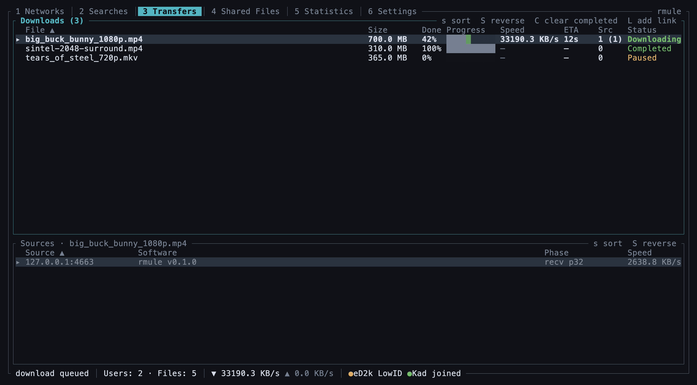
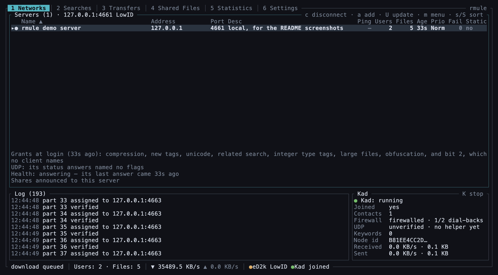
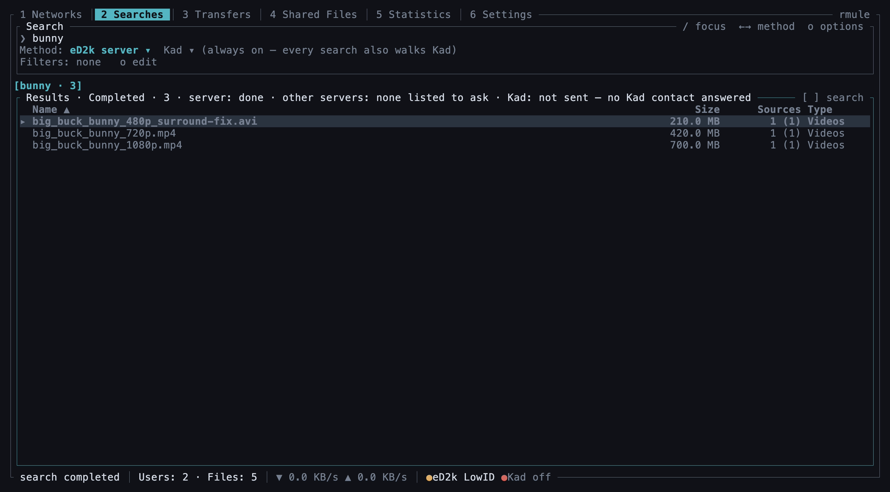
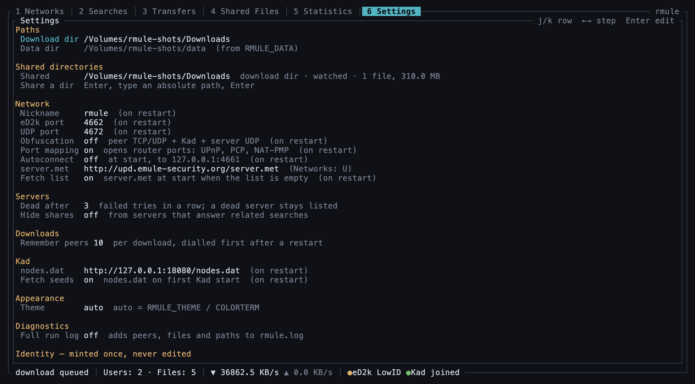

# rmule

rmule is an eD2k and Kad file-sharing client written in Rust. It is built to
behave on the wire the way aMule does: it logs in to eD2k servers, searches,
finds sources, downloads from many peers at once, uploads to others, and runs
a full Kad node. It is library-first: the protocol lives in crates that own no
sockets and no screens, and the two programs are thin front-ends over one core.

Across 143 wire behaviours on six surfaces, rmule matches amuled 2.3.3 on 121,
partly on 10 and differs by design on 12, with none missing; 79 of the 121 are
proven against bytes captured from pinned counterparties. The
[parity tables](docs/protocol/parity/) list every one, and
[Compatibility with aMule](#compatibility-with-amule) says how they are scored.

- **`rmule`** is the terminal client: six tabs, mouse support, no config file
  to write first.
- **`rmule-cli`** is the headless client: one command per run, for scripts.

**Status: 0.1.0, the first public release.** The wire protocol is the most
tested part of rmule; the terminal client is new. There is no daemon and no
remote control yet, and quitting `rmule` stops all transfers (see
[Known limitations](#known-limitations)). Everything may change during 0.x:
commands, key bindings and the data format included.



The screenshots show rmule talking to a local test server and a local
seeder, so every address is `127.0.0.1`, and the seeder is Kad's only
contact.

## Install

### Prebuilt binaries

Every release on the [Releases page](https://github.com/Lazark0x/rmule/releases)
carries an archive per program and platform, named `rmule-<target>` for the
terminal client and `rmule-cli-<target>` for the headless one, for example
`rmule-aarch64-apple-darwin.tar.gz`:

| Platform | Target | Archive |
| --- | --- | --- |
| macOS, Apple silicon | `aarch64-apple-darwin` | `.tar.gz` |
| macOS, Intel | `x86_64-apple-darwin` | `.tar.gz` |
| Linux x64, glibc 2.35 or newer | `x86_64-unknown-linux-gnu` | `.tar.gz` |
| Linux arm64, glibc 2.35 or newer | `aarch64-unknown-linux-gnu` | `.tar.gz` |
| Windows x64 | `x86_64-pc-windows-msvc` | `.zip` |

Each archive holds the binary, `LICENSE`, this README and
`THIRD-PARTY-LICENSES.md`. Each has its own `.sha256` file, and `sha256.sum`
lists them all. The Windows binaries link the C runtime statically, so they
need no Visual C++ redistributable.

Shell and PowerShell installers download the right archive and put the binary
in `~/.local/bin`. They install no updater. For the terminal client:

```sh
# macOS and Linux
curl --proto '=https' --tlsv1.2 -LsSf https://github.com/Lazark0x/rmule/releases/latest/download/rmule-installer.sh | sh
```

```powershell
# Windows
powershell -ExecutionPolicy Bypass -c "irm https://github.com/Lazark0x/rmule/releases/latest/download/rmule-installer.ps1 | iex"
```

For the headless client, the installers are `rmule-cli-installer.sh` and
`rmule-cli-installer.ps1`.

### From source

rmule needs Rust 1.94 or newer (edition 2024) and a C compiler for the `ring`
crate. No other system libraries are needed: HTTPS uses rustls.

```sh
cargo install --locked --git https://github.com/Lazark0x/rmule --tag v0.1.0 rmule
cargo install --locked --git https://github.com/Lazark0x/rmule --tag v0.1.0 rmule-cli
```

`cargo install` builds with your default toolchain. Inside a clone,
`rust-toolchain.toml` pins 1.94.0 with clippy and rustfmt, and rustup uses it
there:

```sh
git clone https://github.com/Lazark0x/rmule
cd rmule
cargo build --release -p rmule -p rmule-cli   # target/release/rmule and rmule-cli
```

## First run

```sh
rmule
```

On its first start rmule creates its [data directory](#data-directory) and
mints a user hash and a Kad node ID. It opens on Networks. Nothing dials an
eD2k server until you say so.

1. **Choose a download directory.** Press `6` for Settings, select
   *Download dir*, press `Enter`, type a path and press `Enter`. rmule warns
   that everything under it will be offered to the network; a second `Enter`
   confirms. Finished files land there, and that directory is shared. Add
   more shared directories in the *Shared directories* section of the same
   tab.
2. **Get a server list.** The list starts empty, so rmule fetches a
   `server.met` at start from aMule's default mirror,
   `http://upd.emule-security.org/server.met`. It does so only while the list
   is empty, and Settings › *Fetch list* turns it off. In Networks (`1`), `U`
   fetches a list from any URL and `a` adds one server as `host:port`.
3. **Connect.** Connecting is yours: select a server in Networks and press
   `c`. To connect at every start instead, turn on *Autoconnect* in Settings.
4. **Kad** starts after the first server login, or at once when you press `K`
   in Networks. If rmule knows no Kad contacts yet, it fetches `nodes.dat` from
   `http://upd.emule-security.org/nodes.dat`. Settings has the URL (*nodes.dat*)
   and an off switch (*Fetch seeds*).
5. **Search and download.** Press `2`, then `/`, type a query and press
   `Enter`. One search goes to the connected server, to other servers over
   UDP and to Kad, and the results merge. Press `Enter` or `m` on a result and
   choose *Download*. Or press `L` on Transfers to paste an `ed2k://` link.





Downloads that were running when you quit start again on the next run.

`rmule --help` prints the options, the data directory in use, and the
environment variables rmule reads.

## Data directory

Both programs find their data directory by the same rule, so they share it.
Two data directories are two separate clients.

| | Unix (Linux and macOS) | Windows |
| --- | --- | --- |
| 1 | `--data-dir <path>` | `--data-dir <path>` |
| 2 | `$RMULE_DATA` | `%RMULE_DATA%` |
| 3 | `$XDG_DATA_HOME/rmule` | `%LOCALAPPDATA%\rmule` |
| 4 | `~/.local/share/rmule` | |

The first rule that gives a path wins, and an empty variable counts as unset.
macOS uses the Unix rule, not `~/Library`. Windows reads neither
`XDG_DATA_HOME` nor `HOME`.

What it holds:

| File | Contents |
| --- | --- |
| `rmule.redb` | identity, preferences, the server list, downloads, the shared-file registry |
| `rmule.log`, `rmule.log.1` | the Run Log; at 16 MiB it moves aside to `rmule.log.1` |
| `clients.met` | the credit other clients have earned with you |
| `nodes.dat` | Kad contacts, kept for the next start |
| `ipfilter.dat`, `ipfilter_static.dat` | the IP filter, if you put one there |

The IP filter is yours to supply: rmule neither fetches nor writes those two
files. `rmule` loads them at start, and `rmule-cli add` loads them too,
`ipfilter_static.dat` on top of `ipfilter.dat`, so the static file wins where
the two overlap. A filtered server is never dialled, and a filtered peer is
never dialled or served. With neither file, nothing is filtered.

The user hash and the Secure User Identification key in `rmule.redb` carry the
credit other clients give you. Back up the directory to keep them.

## Ports and firewall

| Port | Protocol | Carries | Open it inbound? |
| --- | --- | --- | --- |
| 4662 | TCP | connections from other clients | yes, for a High ID |
| 4672 | UDP | Kad, queue reasks between clients, callbacks, NAT traversal | yes |
| server's TCP port + 4 | UDP, outgoing | global search, global sources, server status | no |

Each listening port is bound for IPv4 and IPv6. To change the two ports, edit
*eD2k port* and *UDP port* in Settings and restart rmule; they must differ.
The server UDP socket takes whatever local port the OS gives it.

rmule asks your router to forward both ports, racing PCP, NAT-PMP and UPnP
and keeping the best mapping that works, and removes the mappings on a clean
exit. Settings › *Port mapping* (on by default) turns this off; the change
applies at the next start.

A client that other clients cannot reach gets a Low ID. rmule still works
then: connections are made by callback, through the server, through a Kad
buddy or by a direct UDP request, and rmule can traverse NAT with clients that
support it. A High ID lets more peers reach you.

`rmule-cli add` listens on the stored eD2k port and lets the OS choose its UDP
port.

## Using `rmule`

| Key | Does |
| --- | --- |
| `1`–`6` | Networks · Searches · Transfers · Shared Files · Statistics · Settings |
| `h` / `l` | previous / next tab |
| `[` / `]` | Searches: previous / next search; Shared Files: filter by directory |
| `j` / `k`, `↑` / `↓` | move the selection |
| `g` / `G` | top / bottom |
| `Tab` / `Shift-Tab` | move between panes |
| `m` / `Enter` | the selected row's actions |
| `s` / `S` | sort by the next column / reverse the sort |
| `p` / `C` | pause or resume a download / clear finished downloads |
| `L` | Transfers: add a download from an `ed2k://` link |
| `/`, `o` | Searches: type a query / filter by type, size, sources, extension |
| `x` / `n` | Searches: stop or close a search / ask the server for more results |
| `a`, `U` | Networks: add a server / update the list from a URL |
| `c`, `K` | Networks: connect or disconnect the server / start or stop Kad |
| `Enter`, `←` / `→` | Settings: edit a field / step a choice |
| `?` | every key, with the version |
| `q` | quit |

A click selects a tab or a row, a click on a header sorts, and the wheel
scrolls. Settings marks the choices that take effect on restart.



`rmule --data-dir <path>` picks the data directory and
`rmule --log-level detailed` adds peer addresses, file names, paths and hashes
to the Run Log for one run. `RMULE_THEME` (`dark`, `light` or `256`) picks the
colours. rmule needs a terminal on both its input and its output.

## Using `rmule-cli`

Each command opens the data directory, does one thing and exits.

```sh
rmule-cli identity show                          # user hash, nickname, eD2k port
rmule-cli config set-download-dir ~/Downloads    # where finished files go
rmule-cli config show
rmule-cli server add 203.0.113.5:4661            # add a server
rmule-cli server list
rmule-cli add 'ed2k://|file|name.iso|734003200|<hash>|/'
```

`add` connects to the first server in the list and runs until the download
finishes or fails. A link that names its own sources needs no server. `add`
reads `ipfilter.dat` and `ipfilter_static.dat` from the data directory when
they exist.

`rmule-cli kad join --bootstrap <ip:port>` joins the public Kad network and
reports on the node, for 30 minutes unless `--duration <seconds>` says
otherwise. It is a diagnostic, not a way to run Kad.

`RMULE_LOG` sets the log filter (default `info`); the log goes to stderr.

## Known limitations

- **No daemon and no remote control.** rmule has no External Connections
  (EC) interface, so `amulecmd`, `amuleweb` and the aMule GUI cannot attach to
  it, and quitting `rmule` stops every transfer.
- **No speed limits.** There is no upload or download rate cap.
- **No chat, comments or share browsing.** rmule answers these as an aMule set
  to its most private settings would: peers that ask to browse your shares are
  refused, and rmule holds no Kad notes and searches for none.

On Windows:

- Part files are not sparse on NTFS: a part file takes disk space up to the
  furthest part written, not only for the parts it holds.
- The `.exe` carries no long-path manifest, so Windows' 260-character path
  limit may apply to deep download or shared paths.
- A part file deleted while rmule holds it open is not noticed until the
  handle closes.
- The `.exe` is not signed, so SmartScreen warns on first run.

## Compatibility with aMule

aMule 2.3.3 is the reference for how rmule behaves on the wire. The matrices
in [`docs/protocol/parity/`](docs/protocol/parity/) list aMule's wire behaviour
row by row: 143 rows across server TCP, server UDP, peer TCP, peer UDP, Kad UDP
and the server-list and Kad bootstrap. Each row cites the aMule source it was
read from, states the target (`full`, `graceful`, or `n-a` with its reason),
and gives rmule's status (`at parity`, `partial`, `missing` or `exempt`), the
module that implements it and its evidence: a committed capture from a pinned
counterparty, or the code and its tests alone. An exempt row says why instead.
`python3 docs/protocol/parity/count.py` recounts the tables.

A gap closes only on evidence
([ADR-0045](docs/adr/0045-evidence-standard-per-parity-disposition.md)): a
deterministic regression test for every gap and, for a `full` row, bytes
captured from a real aMule or eD2k server pinned on a local bench, unless that
counterparty is proven defective.

## Documentation

- [`docs/architecture/top-level.md`](docs/architecture/top-level.md): the crate
  map, the layers, and where to start reading the code.
- [`docs/adr/README.md`](docs/adr/README.md): the 110 architecture decisions in
  force, numbered 0001 to 0110.
- [`docs/protocol/`](docs/protocol/): protocol notes, the fixture conventions,
  the map of reference sources and the parity matrices.
- [`docs/reference/`](docs/reference/): pinned external protocol references.
  The metadata is committed; its
  [README](docs/reference/README.md#filling-the-cache) says how to fetch the
  documents it pins.
- [`CONTEXT.md`](CONTEXT.md) and [`CONTEXT-MAP.md`](CONTEXT-MAP.md): the
  project's vocabulary, overall and per crate.

## Contributing

Issues are open: report bugs and ask for features in
[Issues](https://github.com/Lazark0x/rmule/issues). Questions, ideas and
release news live in [Discussions](https://github.com/Lazark0x/rmule/discussions)
(Q&A, Ideas, Announcements).

Pull requests are by invitation. Open an issue first; once it is labelled
`accepted`, a pull request for it is welcome. Every commit needs a
Developer Certificate of Origin sign-off (`git commit -s`).
[`CONTRIBUTING.md`](CONTRIBUTING.md) has the details and the checks a pull
request must pass, and [`CODE_OF_CONDUCT.md`](CODE_OF_CONDUCT.md) applies
everywhere.

Report security problems privately, as [`SECURITY.md`](SECURITY.md) describes,
not in a public issue.

## Licence

rmule is free software under the GNU General Public License, version 3 or (at
your option) any later version: see [`LICENSE`](LICENSE). eMule and aMule are
references for behaviour only. No source code from either is copied,
translated or ported into rmule
([ADR-0004](docs/adr/0004-gpl-3-or-later-and-no-ported-source.md)). The
licences of the crates rmule depends on are listed in
`THIRD-PARTY-LICENSES.md` in every release archive.
